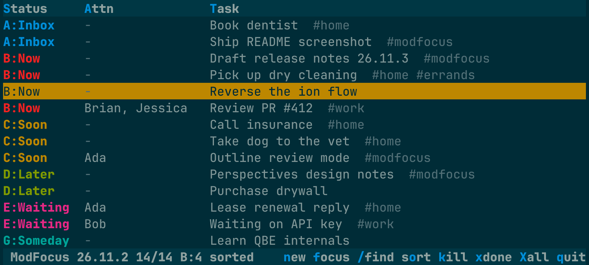

# ModFocus

Focus on the right work — without leaving the shell.

ModFocus is task management for people who live in the terminal. Capture
ideas the moment they arrive, triage them into a clear status ladder, and
narrow the list to who and what you’re dealing with right now. No projects
tree, no nested subtasks — a flat spreadsheet of status, attention, and
title.



### Get it out of your head, fast

Press `n` and type. One line is enough: the title, who’s involved, and the
context. `@Ada` sets Attn. `#work` sets tags. Everything else is the task.

Drop tasks from any shell with `modfocus add` — no TUI required. They land
in Inbox until you’re ready to decide.

### Put every task in its place

Status is the spine of the list. Cycle with `s`:

- **Inbox** — captured, not yet sorted
- **Now** — this week (keep it small)
- **Soon** — next up
- **Later** — parked on purpose
- **Waiting** — ball in their court; Attn says who
- **Someday** — maybe, not forgotten

When Now grows past seven, the footer warns you. That’s the nudge to demote
before the week swallows you.

### See only what matters

A long list stays usable when you can cut it down. Focus (`f`) on an `@name`,
`#tag`, or `:now` / `:waiting` (status). Find (`/`) searches across fields.
`S` cycles status backward. Sort (`o`) restores order: status, then Attn,
then title.

Blue letters in the header and footer mark the shortcuts — the UI teaches
itself as you go.

---

## Install

```bash
brew install jdpalmer/tap/modfocus
```

Works in any TTY. Kitty keyboard protocol (Kitty, Ghostty, and similar) is
preferred for richer key chords; without it, standard keys still work.

Then:

```bash
modfocus
modfocus add @Charles review PR #work
```

---

## Features

#### First-run tutorial

A new store opens with a few `#tutorial` tasks that show capture, status,
focus, Waiting/Attn, and how to clear them. Kill with `k` when you’re done.

#### One-line capture

Type `@names`, `#tags`, and a title in a single field. Tab completes both.
The same language works in the TUI and on the CLI.

#### Quiet Now

The footer counts how many tasks sit in Now. Cross seven and it turns red
with `demote?` — a gentle guardrail against overload.

#### Saves as you go

Edits persist immediately. Point `--db` or `$MFDB` at a synced folder to
share one list across machines.

#### Rotating backups

Each save can mint a backup generation (at most once per hour). If the
primary file is missing, ModFocus restores from the newest backup.

#### Complete, out of the way

Mark done with `x`. Completed tasks stay hidden until you toggle them with
`X`.

---

## Specs

### Requirements

- A TTY (Kitty keyboard protocol preferred for Shift-arrows and friends)
- [modc](https://github.com/jdpalmer/modc) and `modc-qbe` to build from source

### Store

| | |
|---|---|
| Default path | `$MFDB`, or `~/.config/modfocus/tasks.json` |
| Format | JSON |
| Sync | Task-level last-write-wins on idle reload and `--import`; kills leave tombstones so deletes do not resurrect |
| Backups | Rotating `.bak.1` … `.bak.5` beside the store |

### CLI

```bash
modfocus
modfocus --db /path/to/tasks.json
modfocus --import seed.json
modfocus add buy milk
modfocus add @Charles review PR
modfocus add pick up dry cleaning #home #errands
modfocus add --attn Charles --tag work review PR
```

### Keys

| Key | Action |
|-----|--------|
| arrows / `C-n` / `C-p` | Move |
| `S-Up` / `S-Down` / PgUp / PgDn / `C-v` | Page |
| `s` / `S` | Cycle status forward / back (skips Complete) |
| `k` | Kill selected task |
| `x` / `X` | Complete / show completed |
| `o` | Sort |
| `t` / Enter | Edit title |
| `a` | Edit Attn |
| `n` | New task |
| `/` | Find |
| `f` | Focus (`@attn`, `#tag`, or `:status`) |
| `g` / `G` | Top / bottom |
| `C-l` | Redraw |
| `q` | Quit |

Editing uses familiar motion: `C-a` / `C-e`, `C-b` / `C-f`, `C-k`, `C-u`;
Enter accepts, Esc / `C-g` cancels.

### Build & test

```bash
modc build -M . -o modfocus
modc test -M . model
modc test -M . store
modc test -M . cli_add_test.mc
```

### License

MIT. See [LICENSE](LICENSE).
